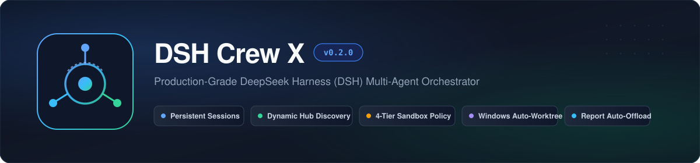
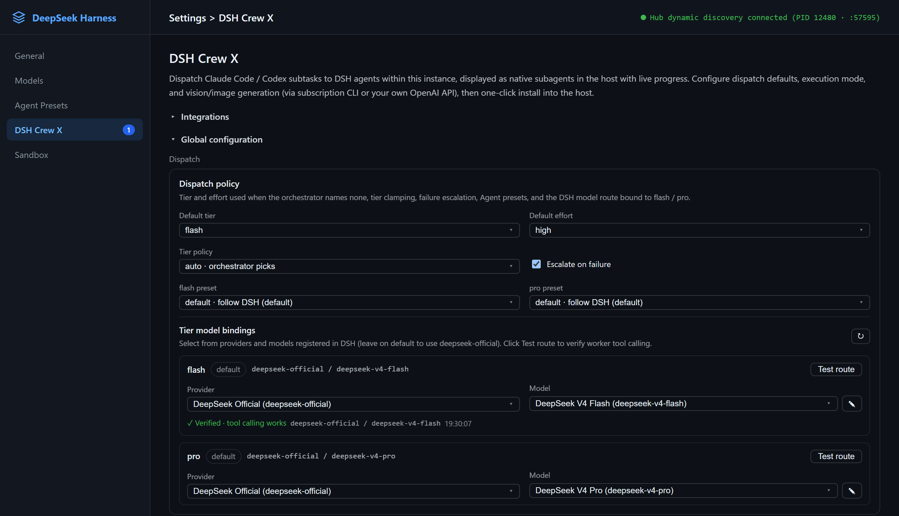
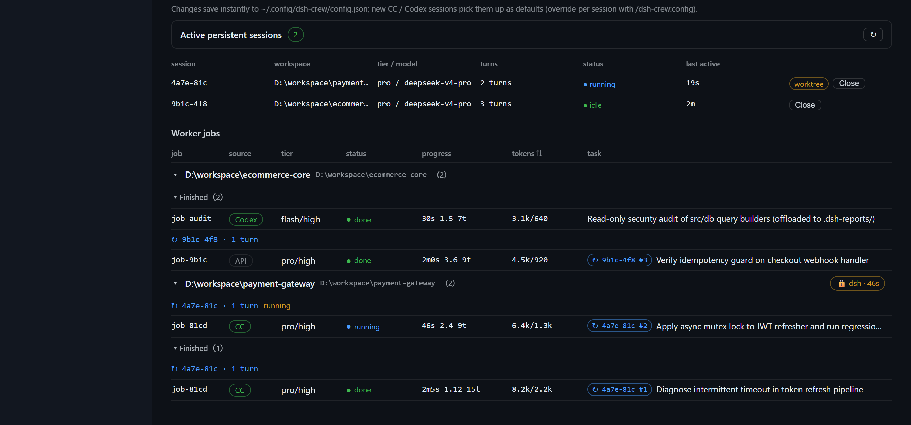
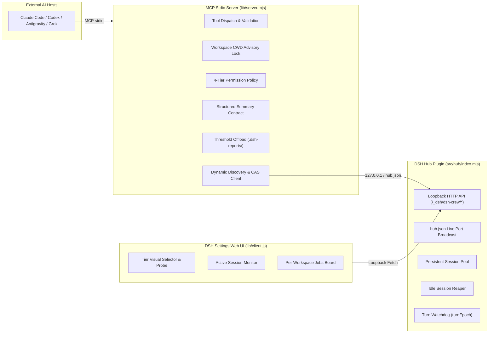

<p align="center">
  
</p>

<p align="center">
  <strong>Production-Grade <a href="https://github.com/deepseek-ai/deepseek-harness">DeepSeek Harness</a> Worker Orchestrator</strong><br />
  <sub>Opt-In Persistent Sessions &bull; Dynamic Hub Discovery &bull; 4-Tier Per-Task Permissions &bull; Windows Auto-Worktree &bull; Threshold Auto-Offload</sub>
</p>

<p align="center">
  <a href="README.md"><strong>English</strong></a> &bull;
  <a href="README.zh.md">简体中文</a>
</p>

<p align="center">
  <a href="https://github.com/xiaobaijiadepugongyingpai-coder/dsh-crew-x/releases"></a>
  <a href="https://github.com/xiaobaijiadepugongyingpai-coder/dsh-crew-x/blob/main/LICENSE"></a>
  <a href="https://nodejs.org/">= 18" /></a>
  
  <a href="https://github.com/ZSeven-W/dsh-crew"></a>
</p>

<p align="center">
  <a href="#-key-differences-from-upstream">vs Upstream</a> &bull;
  <a href="#-production-workflows">Workflows</a> &bull;
  <a href="#-quick-start">Quick Start</a> &bull;
  <a href="#-architecture--mcp-reference">Architecture &amp; Tools</a> &bull;
  <a href="CHANGELOG.md">Changelog</a>
</p>

---

## 🖥️ Control Plane & Live Orchestration

`dsh-crew-x` mounts directly into the **DSH Settings Panel** as both a visual configuration center and a live multi-workspace jobs board:

<p align="center">
  
</p>
<p align="center"><sub>Visual <code>flash</code> / <code>pro</code> provider &amp; model bindings with one-click no-op tool-call route verification</sub></p>

<p align="center">
  
</p>
<p align="center"><sub>Live persistent session pool (with Windows ACL <code>worktree</code> degradation badges) &amp; per-workspace jobs grouping (<code>↻ session #turn</code> &amp; <code>🔒</code> CWD lock)</sub></p>

---

## 📖 Fork Context & Upstream Credit

This repository is a hard fork of [**ZSeven-W/dsh-crew**](https://github.com/ZSeven-W/dsh-crew) (`0.1.0-rc.15`, MIT License).

- **Upstream Credit**: Full credit to `ZSeven-W` for designing the clean three-surface DSH subagent protocol (`Host ↔ MCP ↔ DSH Hub`).
- **Why `dsh-crew-x` Exists**: Upstream keeps execution strictly stateless and minimal. `dsh-crew-x` is engineered for **heavy-duty, multi-turn, and Windows enterprise workflows**—adding opt-in persistent sessions, dynamic port discovery for DSH Desktop, per-task sandboxing with automatic Windows Git Worktree fallback, and threshold-based report offloading.

---

## ⚡ Key Differences from Upstream

| Capability | Upstream `ZSeven-W/dsh-crew` | Enhanced `dsh-crew-x` | Practical Impact |
|---|---|---|---|
| **Session Lifecycle** | Strictly stateless (one-shot); context discarded every turn | **Opt-In Persistent Sessions (`persistent: true`)**<br>1:1 binding, idle reaper (`1–1440m`), turn-level watchdog (`turnEpoch`) | Eliminates redundant repo re-reads and token waste in multi-turn debugging |
| **Hub Discovery** | Static loopback port (`3080`); breaks on port change | **Atomic `hub.json` Discovery + CAS Hot Reconnect** | Works seamlessly with DSH Desktop's randomized ports across restarts |
| **Model Routing** | Manual `config.json` edits with no live validation | **Visual Catalog Dropdowns + Custom IDs + Route Probe** | Enumerates live DSH providers and tests real tool-call capability in one click |
| **Sandbox & Windows ACL** | Global mode; restricted paths fail with `Win32 5 Access Denied` | **4-Tier Per-Task Permissions + Ceiling + Auto-Worktree** | Least-privilege per task; auto-degrades to `%TEMP%\dsh-crew-worktrees` on ACL failure |
| **Output Management** | Full multi-thousand-token output inlined into host chat | **Auto-Offload (`<cwd>/.dsh-reports/`) + Summary Contract** | Saves 85%+ host context window while extracting `VERDICT` / `CHANGED` blocks |
| **Workspace Concurrency** | One worker per directory at a time | **Exclusive Write Lock + `allow_concurrent_cwd` for Reads** | Run multiple parallel `flash` read-only auditors in the same repo safely |

---

## 🎯 Production Workflows

### 1. Parallel Code Auditing Without Context Bloat

<p align="center">
  
</p>

Dispatch multiple `read-only` workers concurrently against the same repository (`allow_concurrent_cwd: true`). Any output exceeding `inline_limit` (default `1500` tokens / `4000` chars) or ending in a non-`done` state is automatically saved to `<cwd>/.dsh-reports/` (with `.gitignore` managed idempotently), returning only the parsed structured summary to the host:

```json
// MCP tool call: dsh_spawn_worker (Worker 1 — Auth Audit)
{
  "task": "Audit src/auth for JWT refresh replay vulnerabilities",
  "tier": "flash",
  "permission": "read-only",
  "allow_concurrent_cwd": true
}
```

```json
// MCP tool call: dsh_spawn_worker (Worker 2 — DB Audit, runs concurrently)
{
  "task": "Audit src/db for SQL injection risks and unindexed queries",
  "tier": "flash",
  "permission": "read-only",
  "allow_concurrent_cwd": true
}
```

---

### 2. Multi-Turn Iterative Debugging (Persistent Sessions)

<p align="center">
  
</p>

Available in **DSH Hub + Antigravity** (opt-in via DSH Settings or `dsh_worker_config({ persistent_sessions: true })`). A forwarding subagent binds 1:1 to a DSH Hub session across turns and explicitly tears it down when done:

```json
// Turn 1 — Create persistent session
// Tool: dsh_run_worker
{
  "task": "Diagnose why test #104 intermittently times out in src/hub/index.mjs",
  "tier": "pro",
  "persistent": true
}
// -> Returns session_id: "sess-9b1c-4f8a", turnIndex: 1
```

```json
// Turn 2 — Continue on the same session (full history & tool outputs preserved)
// Tool: dsh_run_worker
{
  "session_id": "sess-9b1c-4f8a",
  "task": "Apply the turnEpoch guard we identified and run the test suite"
}
```

```json
// Turn 3 — Explicit teardown (registers tombstone; future reuse returns SESSION_CLOSED)
// Tool: dsh_session_close
{
  "session_id": "sess-9b1c-4f8a"
}
```

---

### 3. Windows Desktop Zero-Config & ACL Fallback

- **Dynamic Port Hot-Reconnect**: On boot and on loopback requests, the DSH Hub atomically writes its live URL and PID to `~/.config/dsh-crew/hub.json`. The MCP client resolves live candidates via CAS-protected failover—surviving DSH Desktop restarts with zero manual config.
- **Resilient `auto` Worktree Degradation**: Tasks using `permission: "auto"` execute with `workspace-write`. If Windows restricts directory ACLs (`SetNamedSecurityInfoW` / `Win32 5`), the Hub automatically provisions an isolated Git Worktree under `%TEMP%\dsh-crew-worktrees\<id>` with `.degradation.json` sidecar metadata—keeping external `session_id` and `cwd` validation intact across restarts.

---

## 🚀 Quick Start

### 1. Clone & Build

```bash
git clone https://github.com/xiaobaijiadepugongyingpai-coder/dsh-crew-x.git
cd dsh-crew-x
pnpm install
npm run build
```

### 2. Mount Plugin into DSH

Link the built repository into your DSH profile (recommended for Hub mode):

```bash
dsh plugin --profile web add link:/path/to/dsh-crew-x
dsh web
```

> **Standalone Fallback Only**: When no DSH instance is running, workers can fall back to standalone execution if `DEEPSEEK_API_KEY` is configured in `~/.config/dsh-crew/.env` (see `.env.example`).

### 3. Connect External AI Hosts

Use the built-in installer CLI to register the MCP server, role definitions, skills, and permissions:

```bash
# Install all 4 supported hosts (Claude Code, Codex, Antigravity, Grok)
node src/install/cli.mjs all

# Or install individual hosts:
node src/install/cli.mjs agy --agy-permissions=safe  # Antigravity (auto-allows 4 safe query tools)
node src/install/cli.mjs claude --statusline        # Claude Code (with claude-hud status segment)
node src/install/cli.mjs codex                      # OpenAI Codex CLI
node src/install/cli.mjs grok                       # Grok Build CLI
```

> [!WARNING]
> **Migration & Breaking Changes**:
> 1. **Do Not Mix**: Never enable upstream `@zseven-w/dsh-crew` and `dsh-crew-x` simultaneously in the same host—MCP tool names will collide.
> 2. **Async Persistent Refusal**: `dsh_spawn_worker` strictly runs in one-shot mode. Passing `persistent` or `session_id` (even `false` or `""`) is explicitly rejected with `PERSISTENT_ASYNC_UNSUPPORTED`.
> 3. **Worktree Metadata**: When an `auto` task triggers Windows ACL fallback, the response explicitly includes `worktree_path` and `isolation: true`.

---

## 🏗️ Architecture & MCP Reference



### 🛠️ 8 MCP Tools

| Tool | Role | Key Parameters |
|---|---|---|
| `dsh_run_worker` | Blocking execution (supports persistent sessions) | `task`, `tier`, `effort`, `cwd`, `timeout_seconds`, `permission`, `preset`, `allow_concurrent_cwd`, `persistent`, `session_id`, `inline_limit`, `full_reply` |
| `dsh_spawn_worker` | Asynchronous background dispatch (one-shot only) | `task`, `tier`, `effort`, `cwd`, `permission`, `preset`, `allow_concurrent_cwd` |
| `dsh_worker_status` | List live Hub / Standalone / CLI jobs & CWD locks | *(none)* |
| `dsh_worker_result` | Retrieve settled output with summary extraction | `job_id`, `wait_seconds`, `inline_limit`, `full_reply` |
| `dsh_worker_cancel` | Terminate a running worker and release its CWD lock | `job_id` |
| `dsh_worker_config` | Inspect or override session configuration at runtime | `persistent_sessions`, `default_tier`, `mode`, `report_dir`, `preset_flash`, `preset_pro`, `flash_provider`, `flash_model`, `reset`, etc. |
| `dsh_worker_probe` | Zero-side-effect no-op tool-call route probe | `tier`, `provider`, `model` |
| `dsh_session_close` | Explicitly destroy a persistent session (tombstone) | `session_id` |

<details>
<summary><strong>⚙️ Configuration, Environment Variables &amp; Verification Gates</strong></summary>

#### Global Config: `~/.config/dsh-crew/config.json`
```jsonc
{
  "mode": "auto",                                    // auto | hub | standalone
  "default_tier": "flash",                           // flash | pro
  "default_effort": "high",                          // off | high | max
  "persistent_sessions": false,                      // Global opt-in toggle
  "persistent_session_idle_timeout_enabled": true,   // Auto-reap idle sessions
  "persistent_session_idle_timeout_minutes": 30,     // Idle threshold (1–1440 min)
  "preset_flash": "default",                         // DSH agent preset for flash
  "preset_pro": "default",                           // DSH agent preset for pro
  "report_dir": ""                                   // Custom report path (empty = <cwd>/.dsh-reports/)
}
```

#### Environment Variables
- `DSH_CREW_MAX_PERMISSION`: Enforces non-escalating permission ceiling (`read-only` | `workspace-write` | `auto` | `full-access`).
- `DSHPLUGIN_CREW_HUB`: Overrides `hub.json` discovery with a fixed loopback Hub URL.
- `DSH_CREW_ORIGIN_CHAIN` / `DSH_CREW_DEPTH`: Tracks cross-process dispatch chains to block cycles and limit recursion depth (default `3`).

#### Local Verification Gates
```bash
npx tsc -p tsconfig.client.json --noEmit
npm run build
npm test
node scripts/verify-wpc10-client.mjs
npm run smoke:cwd
npm run smoke:mcp
```

</details>

---

## 📄 License & Credits

Licensed under the **[MIT License](LICENSE)**.

- **Upstream**: Copyright (c) 2026 [ZSeven-W](https://github.com/ZSeven-W/dsh-crew)
- **Fork Enhancements**: Copyright (c) 2026 [xiaobaijiadepugongyingpai-coder](https://github.com/xiaobaijiadepugongyingpai-coder)
