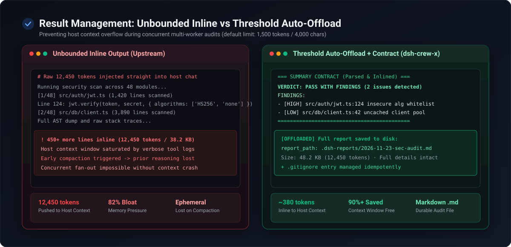
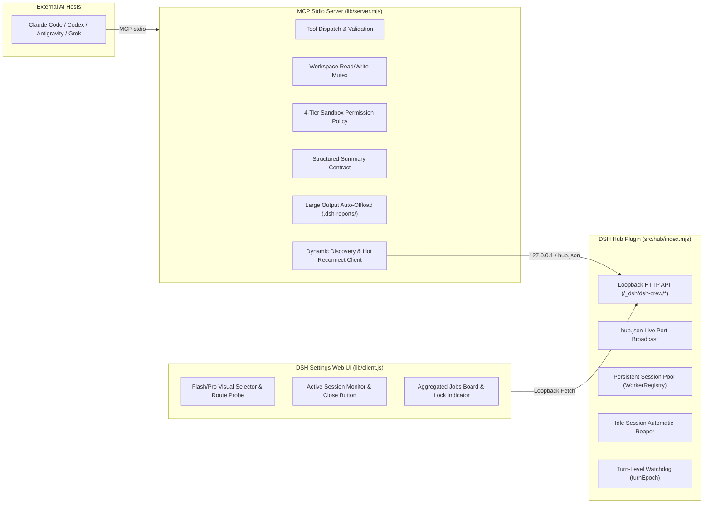

# DSH Crew X (`dsh-crew-x`)

<p align="center">
  <strong>Production-Grade DeepSeek Harness (DSH) Worker Orchestrator</strong><br />
  Long-lived Persistent Sessions &middot; Dynamic Port Hot Reconnect &middot; Per-Task Fine-Grained Permissions &middot; Windows Worktree Isolation &middot; Large Output Auto-Offload
</p>

<p align="center">
  <a href="README.md"><strong>English</strong></a> &bull;
  <a href="README.zh.md">简体中文</a>
</p>

<p align="center">
  <a href="https://www.npmjs.com/package/dsh-crew-x"></a>
  <a href="https://github.com/xiaobaijiadepugongyingpai-coder/dsh-crew-x/blob/main/LICENSE"></a>
  <a href="https://nodejs.org/"></a>
  <a href="https://github.com/ZSeven-W/dsh-crew"></a>
</p>

<p align="center">
  
</p>

---

## 📖 Open Source Acknowledgements & Fork Notice

This project is hard forked from [ZSeven-W/dsh-crew](https://github.com/ZSeven-W/dsh-crew) under the terms of the MIT License.

- **Upstream Credit**: Special thanks to `ZSeven-W` for creating and architecting the clean, elegant DSH subagent protocol and three-surface framework.
- **Divergence & Evolution**:
  - **Upstream Project**: Focused on keeping the core clean, lightweight, and strictly stateless (one-shot), maintaining minimal DSH settings panel options and Hub configs.
  - **DSH Crew X**: Tailored specifically for **heavy-duty production engineering and multi-agent enterprise workflows**. It addresses complex multi-turn collaboration, large-scale concurrent code audits, Windows enterprise security hurdles, and context window exhaustion by introducing persistent session pools, automatic worktree isolation, result offloading, and deep stability hardening.

---

## ⚡ Key Differences from Upstream

| Dimension | Upstream `ZSeven-W/dsh-crew` | Enhanced `dsh-crew-x` | Practical Benefits |
|---|---|---|---|
| **Session Model** | Purely stateless (one-shot); all context discarded upon task completion | **Opt-In Persistent Sessions**<br>1:1 forwarding subagent binding with idle reaper & turn watchdog | Eliminates repeated file re-reads & token wastage in iterative multi-turn bug-fixing |
| **Connection & Discovery** | Fixed loopback port (default `3080`); crashes with `ECONNREFUSED` on port changes | **Atomic File Discovery (`hub.json`) + CAS Hot Reconnect** | Perfect for DSH Desktop dynamic random ports; reconnects seamlessly after restarts |
| **Model Routing** | Hand-edited `config.json` without validation or live feedback | **Visual Dropdowns + Custom ID Input + Real Tool-Call Probe Button** | Live inspection of registered providers & instant no-op tool-call route verification |
| **Sandbox & Permissions** | Static global mode; restricted Windows directories crash with `Win32 5 Access Denied` | **4-Tier Per-Task Permissions + Ceiling + Windows Auto-Worktree Fallback** | Least-privilege execution; auto-degrades to isolated Git Worktree on Windows ACL issues without failing |
| **Output Management** | Entire 10,000+ token reviews returned inline, easily overflowing context windows | **Threshold Auto-Offload (`<cwd>/.dsh-reports/`) + Structured Summary Contract** | Saves 85%+ context window space; extracts structured `VERDICT` / `CHANGED` findings |
| **Concurrency & Locks** | Shared workspace (CWD) strictly serialized | **Exclusive Write Locks + Concurrent Read-Only Dispatches (`allow_concurrent_cwd`)** | Enables running multiple parallel Flash workers for rapid multi-module code audits |

---

## 🎯 Three Real-World Production Scenarios

### Scenario 1: Large-Scale Concurrent Code Auditing (Parallel Reads + Auto-Offload)

<p align="center">
  
</p>

- **Problem**: In standard workflows, a single workspace can only run one worker at a time; deep security audits returning tens of thousands of tokens quickly overwhelm Claude, Codex, or Antigravity context windows.
- **Solution**: Spawn multiple read-only workers concurrently by setting `allow_concurrent_cwd: true` and `permission: "read-only"`. Excessive outputs are automatically saved to disk, returning only structured summaries.

```javascript
// Worker 1: Audit auth module
dsh_spawn_worker({
  task: "Audit src/auth for JWT refresh replay vulnerabilities",
  tier: "flash",
  permission: "read-only",
  allow_concurrent_cwd: true
});

// Worker 2: Concurrently audit database queries without blocking
dsh_spawn_worker({
  task: "Audit src/db for SQL injection risks and slow query patterns",
  tier: "flash",
  permission: "read-only",
  allow_concurrent_cwd: true
});
```

---

### Scenario 2: Multi-Turn Iterative Bug Fixing (Persistent Session Mode)

<p align="center">
  
</p>

- **Problem**: Complex issues require an iterative loop: root-cause analysis ➔ reproduction test ➔ code fix ➔ regression check. In a stateless model, each turn forces the worker to read the entire codebase all over again.
- **Solution**: Bind a long-lived persistent session to carry forward full memory, tool results, and reasoning chains.

```javascript
// Turn 1: Launch persistent session for root cause investigation
const step1 = await dsh_run_worker({
  task: "Diagnose why unit test #104 occasionally times out in src/hub/index.mjs",
  tier: "pro",
  persistent: true
});
// ➜ Returns session_id: "session-9b1c-4f8a" with the root cause explanation

// Turn 2: Continue in the same session to write the fix (inherits all Turn 1 context)
const step2 = await dsh_run_worker({
  session_id: "session-9b1c-4f8a",
  task: "Apply the mutex lock fix we discussed in turn 1 and run the unit test suite"
});

// Turn 3: Work complete, destroy the session explicitly
await dsh_session_close({
  session_id: "session-9b1c-4f8a"
});
```

---

### Scenario 3: Windows Desktop Zero-Config Plug-and-Play (Dynamic Discovery + Auto-Worktree)

- **Problem**: DSH Desktop generates a randomized port on every startup; modifying protected branches or restricted paths triggers Windows `Win32 5 Access Denied` errors.
- **Solution**:
  1. The Hub broadcasts its live port to `~/.config/dsh-crew/hub.json`, and the MCP client performs CAS-governed automatic failover.
  2. Tasks defaulting to `permission: "auto"` gracefully transition to a clean temporary Git Worktree at `%TEMP%\dsh-crew-worktrees\<id>` upon encountering ACL limitations, surviving DSH restarts seamlessly.

---

## 🚀 Quick Start & Integration

### 1. Installation

#### Option A: Install from npm
```bash
npm install -g dsh-crew-x
```

#### Option B: Build from Source
```bash
git clone https://github.com/xiaobaijiadepugongyingpai-coder/dsh-crew-x.git
cd dsh-crew-x
pnpm install
npm run build
```

### 2. Connect External AI Hosts

`dsh-crew-x` includes an installer CLI to configure external coding assistants in one command:

```bash
# Register all supported hosts (Claude Code, Codex, Antigravity, Grok)
node src/install/cli.mjs all

# Or configure specific hosts:
node src/install/cli.mjs agy --agy-permissions=safe  # Antigravity (auto-allows safe query tools)
node src/install/cli.mjs claude --statusline        # Claude Code (with optional statusline)
node src/install/cli.mjs codex                      # OpenAI Codex
node src/install/cli.mjs grok                       # Grok Build CLI
```

> [!WARNING]
> **Migration Notices & Breaking Changes**:
> 1. **Do Not Mix**: Avoid running upstream `@zseven-w/dsh-crew` and `dsh-crew-x` simultaneously within the same host to prevent MCP tool name collisions.
> 2. **Async Persistent Refusal**: `dsh_spawn_worker` strictly operates in one-shot mode. Passing `persistent: true` or `session_id` will be explicitly refused with `PERSISTENT_ASYNC_UNSUPPORTED` (upstream silently stripped unknown fields).
> 3. **Windows Worktree Signals**: When an `auto` task triggers an ACL degradation, the response payload explicitly includes `worktree_path` and `isolation: true`.

---

## 🏗️ Architecture & Interface Reference



### 🛠️ 8 MCP Tools Reference

| Tool Name | Purpose | Key Parameters |
|---|---|---|
| `dsh_run_worker` | Blocking execution (supports persistent session) | `task`, `tier`, `effort`, `permission`, `preset`, `persistent`, `session_id`, `inline_limit`, `full_reply` |
| `dsh_spawn_worker` | Asynchronous background dispatch | `task`, `tier`, `effort`, `permission`, `preset`, `allow_concurrent_cwd` |
| `dsh_worker_status` | Inspect live task progress & CWD advisory locks | None |
| `dsh_worker_result` | Retrieve settled task result with summary parsing | `job_id`, `wait_seconds`, `inline_limit`, `full_reply` |
| `dsh_worker_cancel` | Terminate running task and release its CWD lock | `job_id` |
| `dsh_worker_config` | Inspect or override session configuration | `persistent_sessions`, `default_tier`, `mode`, `report_dir`, `preset_flash`, `preset_pro`, etc. |
| `dsh_worker_probe` | Test route connectivity with a no-op tool call | `tier`, `provider`, `model` |
| `dsh_session_close` | Explicitly destroy persistent session with tombstone | `session_id` |

<details>
<summary><strong>⚙️ Configuration & Environment Variables (Click to expand)</strong></summary>

#### Configuration File: `~/.config/dsh-crew/config.json`
```jsonc
{
  "mode": "auto",                                    // auto | hub | standalone
  "default_tier": "flash",                           // flash | pro
  "default_effort": "high",                          // off | high | max
  "persistent_sessions": false,                      // Global toggle for persistent sessions
  "persistent_session_idle_timeout_enabled": true,   // Auto-reap idle sessions toggle
  "persistent_session_idle_timeout_minutes": 30,     // Idle timeout threshold (1-1440 min)
  "preset_flash": "default",                         // Agent preset for Flash tier
  "preset_pro": "default",                           // Agent preset for Pro tier
  "report_dir": ""                                   // Custom path for reports (empty = default)
}
```

#### Key Environment Variables
- `DSH_CREW_MAX_PERMISSION`: Caps maximum permissible sandbox privileges (`read-only` \| `workspace-write` \| `auto` \| `full-access`).
- `DSHPLUGIN_CREW_HUB`: Override URL to force a fixed Hub loopback address.
- `DSH_CREW_ORIGIN_CHAIN` / `DSH_CREW_DEPTH`: Protects against cyclic dispatch loops and recursion deadlocks.

</details>

---

## 📄 License & Credits

This project is licensed under the **[MIT License](LICENSE)**.

- Upstream Copyright: Copyright (c) 2026 ZSeven-W
- Enhanced Fork Copyright: Copyright (c) 2026 xiaobaijiadepugongyingpai-coder

Our sincere gratitude to the upstream [ZSeven-W/dsh-crew](https://github.com/ZSeven-W/dsh-crew) community for providing the foundational architecture.
