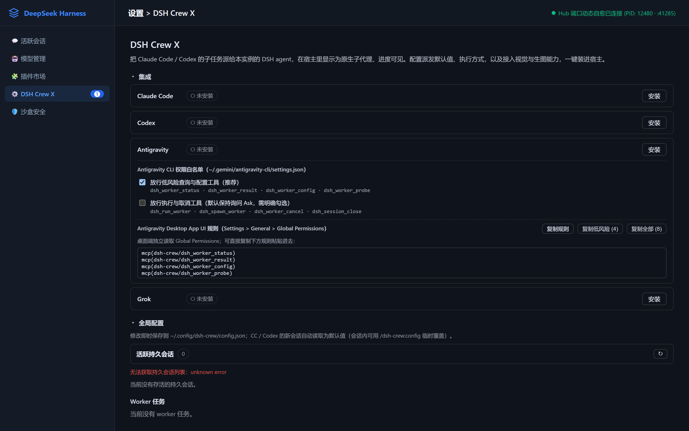
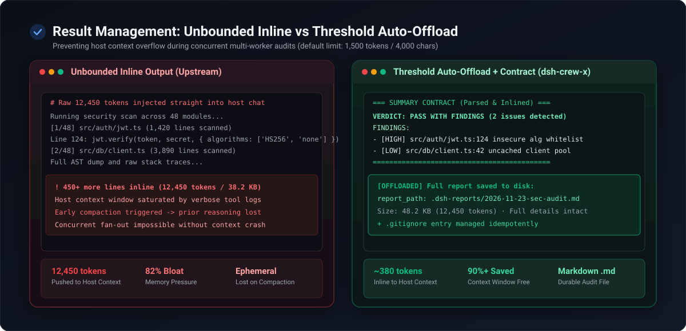
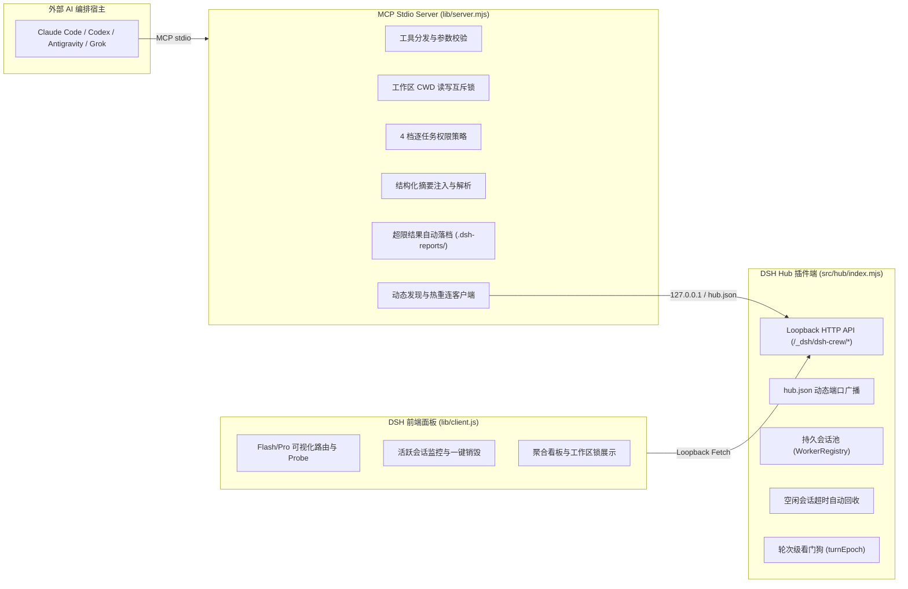

# DSH Crew X (`dsh-crew-x`)

<p align="center">
  <strong>面向重度生产级研发的 DeepSeek Harness (DSH) Worker 编排插件</strong><br />
  长效持久会话 &middot; 动态端口热重连 &middot; 逐任务细粒度沙盒 &middot; Windows 智能 Worktree 降级 &middot; 超限大结果自动落档
</p>

<p align="center">
  <a href="README.md">English</a> &bull;
  <a href="README.zh.md"><strong>简体中文</strong></a>
</p>

<p align="center">
  <a href="https://www.npmjs.com/package/dsh-crew-x"></a>
  <a href="https://github.com/xiaobaijiadepugongyingpai-coder/dsh-crew-x/blob/main/LICENSE"></a>
  <a href="https://nodejs.org/"></a>
  <a href="https://github.com/ZSeven-W/dsh-crew"></a>
</p>

<p align="center">
  
</p>

---

## 📖 开源致谢与分叉说明

本项目基于 MIT 协议分叉（Hard Fork）自 [ZSeven-W/dsh-crew](https://github.com/ZSeven-W/dsh-crew)。

- **致谢上游**：衷心感谢原作者 `ZSeven-W` 设计并实现了精简优雅的 DSH 子代理调度协议与三端基础架构。
- **分叉定位与演进方向**：
  - **上游原项目**：专注保持核心逻辑精简、轻量无状态（One-shot），维护极简的 DSH 设置面板与 Hub 接入配置。
  - **DSH Crew X**：定位为**重度研发与生产级自动化场景的独立增强版**。面向复杂多轮协同、大规模并发代码审计、企业级 Windows 开发以及超长上下文消耗等真实痛点，持续提供持久会话池、智能沙盒容灾降级、大结果落档与深层稳定性硬化。

---

## ⚡ 与原版核心差异对比

| 维度 | 原版 `ZSeven-W/dsh-crew` | 增强版 `dsh-crew-x` | 核心收益 |
|---|---|---|---|
| **会话模型** | 纯单次无状态（One-shot），任务结束即丢弃全部上下文 | **可选持久会话（Opt-In Persistent Sessions）**<br>1:1 绑定长效会话，内置空闲回收与看门狗 | 支持复杂 Bug 多轮修复与连续追问，告别重复读取项目与巨额 Token 浪费 |
| **连接与发现** | 固定端口（默认 `3080`），端口变动即报 `ECONNREFUSED` 失联 | **原子文件动态发现（`hub.json`）+ CAS 热切流** | 完美适配 DSH Desktop 随机端口，重启免重配无缝重连 |
| **模型路由绑定** | 手写 `config.json`，无可用性校验与可视化引导 | **可视化下拉选单 + 自定义输入 + 一键真实连通性 Probe** | 实时枚举 DSH 已接入 Provider，一键发送无副作用探针验证真实 tool-call 能力 |
| **沙盒与权限** | 静态全局权限；Windows 受限目录写操作直接报 `Win32 5` 崩溃 | **4 档逐任务权限 + 权限天花板 + Windows 智能 Worktree 降级** | 最小权限原则落地；Windows 遇权限受限自动降级至隔离临时 Git Worktree 并无缝续跑 |
| **结果输出管理** | 全量 10,000+ 字审查结果直接回传，极易冲垮主模型上下文 | **超限阈值自动落档（`<cwd>/.dsh-reports/`）+ 结构化摘要契约** | 节省 85%+ 主会话上下文，提取 `VERDICT` / `CHANGED` 等确定性结构化结论 |
| **并发与锁机制** | 同一工作区（CWD）完全互斥串行 | **排他写锁 + 只读并发放行（`allow_concurrent_cwd`）** | 允许同时启动多个 Flash Worker 进行大规模多模块并行审计与探索 |

---

## 🎯 三大典型实战场景

### 场景 1：大规模并发代码只读审计（并发只读 + 自动落档）

<p align="center">
  
</p>

- **场景痛点**：在传统模式下，同一个项目目录同一时刻只能运行一个 Worker；如果派发深度安全审计，几万字的详细分析报告直接回传，将瞬间挤爆 Claude / Codex / Antigravity 的上下文窗口。
- **解决方案**：派发多个只读 Worker，指定 `allow_concurrent_cwd: true` 与 `permission: "read-only"`。超限报告自动落档至本地，主模型仅接收极简摘要。

```javascript
// Worker 1: 审查认证模块
dsh_spawn_worker({
  task: "全面审查 src/auth 模块中的 JWT 刷新机制是否存在重放漏洞",
  tier: "flash",
  permission: "read-only",
  allow_concurrent_cwd: true
});

// Worker 2: 同时审查数据库查询模块（同一目录互不阻塞）
dsh_spawn_worker({
  task: "审查 src/db 模块中的 SQL 拼接风险与慢查询问题",
  tier: "flash",
  permission: "read-only",
  allow_concurrent_cwd: true
});
```

---

### 场景 2：跨轮次持续迭代与复杂缺陷修复（持久会话模式）

<p align="center">
  
</p>

- **场景痛点**：复杂 Bug 往往需要经过“分析原因 ➔ 编写复现用例 ➔ 实施修复 ➔ 验证测试”多轮迭代。无状态模式下，下一轮 Worker 无法继承上一轮的对话记忆，必须从头重新阅读全部代码。
- **解决方案**：使用 `dsh-crew-x` 提供的持久会话绑定机制，保持活体上下文无缝追加。

```javascript
// 【第 1 轮】：创建长效会话并开展根因分析
const step1 = await dsh_run_worker({
  task: "定位 #104 单元测试偶尔超时的原因，检查 src/hub/index.mjs 的竞态逻辑",
  tier: "pro",
  persistent: true
});
// ➜ 返回 session_id: "session-9b1c-4f8a" 与初步排查分析

// 【第 2 轮】：直接复用该会话实施修复（完全继承第 1 轮上下文与探索记录）
const step2 = await dsh_run_worker({
  session_id: "session-9b1c-4f8a",
  task: "按照你刚刚确认的方案实施加锁修复，并执行测试"
});

// 【第 3 轮】：修复完成，显式销毁会话释放资源
await dsh_session_close({
  session_id: "session-9b1c-4f8a"
});
```

---

### 场景 3：Windows 桌面端零配置即插即用（动态端口 + 智能 Worktree 降级）

- **场景痛点**：Windows DSH 桌面端每次重启端口完全随机；在系统受限目录或受保护的分支上运行修改任务时，频频触发 `Win32 5 Access Denied` 抛错崩溃。
- **解决方案**：
  1. 插件启动时原子更新 `~/.config/dsh-crew/hub.json`，MCP 客户端通过 CAS 状态机制秒级自愈重连。
  2. 任务默认采用 `permission: "auto"`，在遭遇 ACL 权限限制时自动无缝降级到 `%TEMP%\dsh-crew-worktrees\<id>`，保持对外接口路径不变，并在 DSH 重启后依然可以持续追踪。

---

## 🚀 快速上手与宿主接入

### 1. 安装方式

#### 方式 A：通过 npm 全局 / 局部安装
```bash
npm install -g dsh-crew-x
```

#### 方式 B：从源码构建安装
```bash
git clone https://github.com/xiaobaijiadepugongyingpai-coder/dsh-crew-x.git
cd dsh-crew-x
pnpm install
npm run build
```

### 2. 一键接入外部 AI 编排宿主

`dsh-crew-x` 提供集成 CLI，可将 MCP 服务的配置与角色技能一键注入到各个宿主环境中：

```bash
# 一键接入全部支持的宿主（Claude Code、Codex、Antigravity、Grok）
node src/install/cli.mjs all

# 或按需接入指定宿主：
node src/install/cli.mjs agy --agy-permissions=safe  # Antigravity（默认放行安全只读查询）
node src/install/cli.mjs claude --statusline        # Claude Code（可选启用状态栏）
node src/install/cli.mjs codex                      # OpenAI Codex
node src/install/cli.mjs grok                       # Grok Build CLI
```

> [!WARNING]
> **迁移破坏性变更与兼容提示（Breaking Changes）**：
> 1. **严禁混用**：请不要在同一 AI 宿主中同时启用原版 `@zseven-w/dsh-crew` 和 `dsh-crew-x`，以免 MCP 工具名称发生冲突。
> 2. **异步持久参数拒绝**：异步后台派发工具 `dsh_spawn_worker` 不支持持久会话。传入 `persistent: true` 或 `session_id` 将被显式拒绝并返回 `PERSISTENT_ASYNC_UNSUPPORTED`（原版会静默剥离作为一次性任务派发）。
> 3. **Windows 智能降级标识**：当 `auto` 权限任务触发 Windows ACL 降级时，返回结果中会显式附带 `worktree_path` 与 `isolation: true`。

---

## 🏗️ 架构与系统接口总览



### 🛠️ 8 个 MCP 工具参考

| 工具名称 | 功能定位 | 核心入参 |
|---|---|---|
| `dsh_run_worker` | 阻塞式执行任务（支持持久会话） | `task`, `tier`, `effort`, `permission`, `preset`, `persistent`, `session_id`, `inline_limit`, `full_reply` |
| `dsh_spawn_worker` | 异步后台派发任务 | `task`, `tier`, `effort`, `permission`, `preset`, `allow_concurrent_cwd` |
| `dsh_worker_status` | 查询任务实时进度与工作区 CWD 锁状态 | 无参数 |
| `dsh_worker_result` | 拉取异步任务结算结果（带摘要解析） | `job_id`, `wait_seconds`, `inline_limit`, `full_reply` |
| `dsh_worker_cancel` | 取消执行中的任务并释放工作区写锁 | `job_id` |
| `dsh_worker_config` | 查看或动态覆盖会话配置 | `persistent_sessions`, `default_tier`, `mode`, `report_dir`, `preset_flash`, `preset_pro` 等 |
| `dsh_worker_probe` | 无副作用验证指定模型路由的工具调用能力 | `tier`, `provider`, `model` |
| `dsh_session_close` | 显式销毁持久会话并写入墓碑标记 | `session_id` |

<details>
<summary><strong>⚙️ 配置文件与环境变量说明（点击展开）</strong></summary>

#### 配置文件：`~/.config/dsh-crew/config.json`
```jsonc
{
  "mode": "auto",                                    // auto | hub | standalone
  "default_tier": "flash",                           // flash | pro
  "default_effort": "high",                          // off | high | max
  "persistent_sessions": false,                      // 持久会话全局开关
  "persistent_session_idle_timeout_enabled": true,   // 空闲自动回收开关
  "persistent_session_idle_timeout_minutes": 30,     // 空闲超时阈值（1-1440 分钟）
  "preset_flash": "default",                         // Flash 绑定的 Agent 预设
  "preset_pro": "default",                           // Pro 绑定的 Agent 预设
  "report_dir": ""                                   // 自定义报告存储路径（留空走默认）
}
```

#### 关键环境变量
- `DSH_CREW_MAX_PERMISSION`：强制锁定任务权限天花板（`read-only` \| `workspace-write` \| `auto` \| `full-access`）。
- `DSHPLUGIN_CREW_HUB`：手动指定固定的 Hub 回环地址（覆盖动态端口发现）。
- `DSH_CREW_ORIGIN_CHAIN` / `DSH_CREW_DEPTH`：自动追踪调用链，防止循环调用与递归死锁。

</details>

---

## 📄 开源许可与致谢

本项目采用 **[MIT 许可证](LICENSE)**。

- 原项目版权：Copyright (c) 2026 ZSeven-W
- 本项目增强版版权：Copyright (c) 2026 xiaobaijiadepugongyingpai-coder

再次向上游 [ZSeven-W/dsh-crew](https://github.com/ZSeven-W/dsh-crew) 社区致以崇高敬意！
