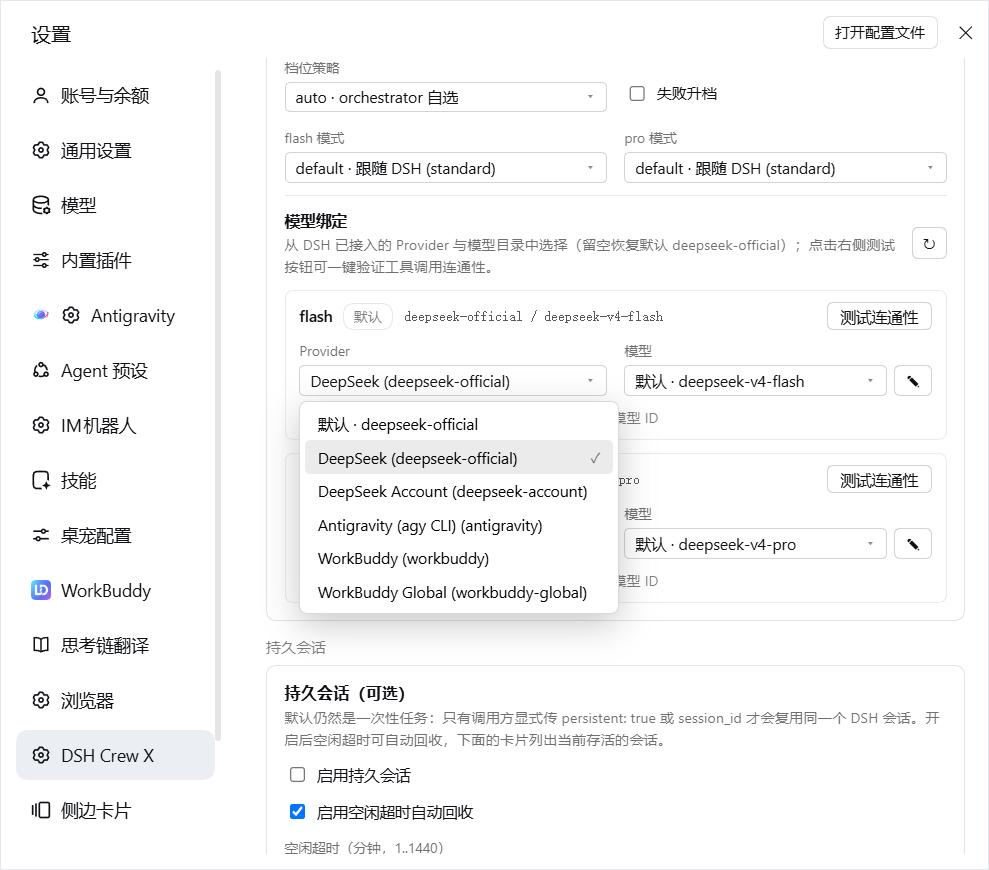
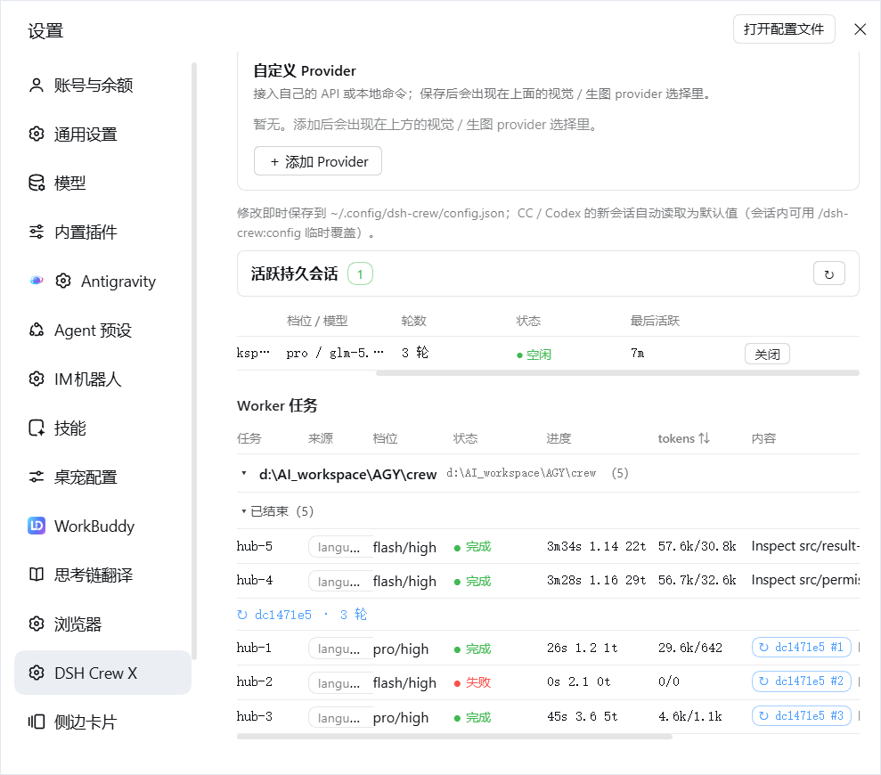
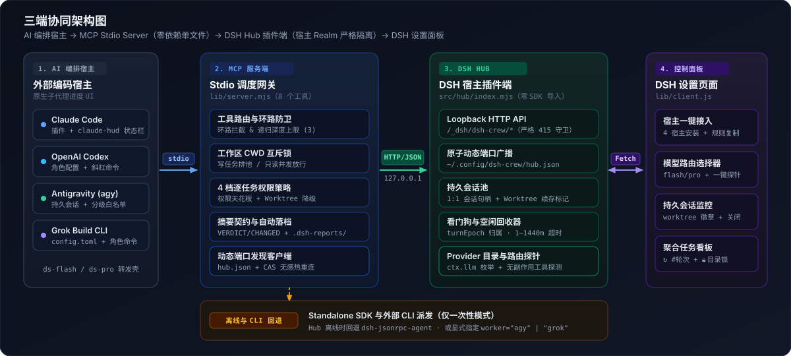

<p align="center">
  
</p>

<p align="center">
  <strong>面向生产级多代理研发的 <a href="https://github.com/deepseek-ai/deepseek-harness">DeepSeek Harness</a> Worker 编排插件</strong><br />
  <sub>可选持久会话 &bull; 动态端口热重连 &bull; 逐任务 4 档沙盒权限 &bull; Windows 智能 Worktree 降级 &bull; 超限结果自动落档</sub>
</p>

<p align="center">
  <a href="README.md">English</a> &bull;
  <a href="README.zh.md"><strong>简体中文</strong></a>
</p>

<p align="center">
  <a href="https://www.npmjs.com/package/dsh-crew-x"></a>
  <a href="https://github.com/xiaobaijiadepugongyingpai-coder/dsh-crew-x/releases"></a>
  <a href="https://github.com/xiaobaijiadepugongyingpai-coder/dsh-crew-x/blob/main/LICENSE"></a>
  <a href="https://nodejs.org/">= 18" /></a>
  
  <a href="https://github.com/ZSeven-W/dsh-crew"></a>
</p>

<p align="center">
  <a href="#-与原版核心差异对比">与原版差异</a> &bull;
  <a href="#-三大实战场景">实战场景</a> &bull;
  <a href="#-快速上手">快速上手</a> &bull;
  <a href="#-架构与-mcp-工具参考">架构与工具</a> &bull;
  <a href="CHANGELOG.md">更新日志</a>
</p>

---

## 🖥️ 控制面板与实时任务看板

`dsh-crew-x` 直接集成在 **DSH 设置面板**中，提供可视化模型路由探测、持久会话池管理与按工作区聚合的实时看板：

<p align="center">
  
</p>
<p align="center"><sub>DSH Desktop 实机截图：<code>flash</code> / <code>pro</code> 可视化 Provider 与模型选择、预设绑定、一键连通性探针与持久会话开关</sub></p>

<p align="center">
  
</p>
<p align="center"><sub>DSH Desktop 实机截图：活跃持久会话池与按工作区聚合的任务看板（<code>↻ 会话 #轮次</code> 徽章与并发只读任务）</sub></p>

---

## 📖 开源致谢与分叉说明

本项目基于 MIT 协议硬分叉（Hard Fork）自 [**ZSeven-W/dsh-crew**](https://github.com/ZSeven-W/dsh-crew)（`0.1.0-rc.15`）。

- **致谢上游**：衷心感谢原作者 `ZSeven-W` 设计并实现了精简优雅的 DSH 三端调度协议（`Host ↔ MCP ↔ DSH Hub`）。
- **为什么会有 `dsh-crew-x`**：上游版本坚持极简与纯无状态（One-shot）设计；而 `dsh-crew-x` 面向**重度生产级研发、复杂多轮协同与 Windows 企业环境**，补充了可选持久会话池、桌面端动态端口自动发现、逐任务权限与 Windows Worktree 自动降级，以及超限结果自动落档等工程硬化能力。

---

## ⚡ 与原版核心差异对比

| 能力维度 | 原版 `ZSeven-W/dsh-crew` | 增强版 `dsh-crew-x` | 实际收益 |
|---|---|---|---|
| **会话生命周期** | 纯无状态（One-shot），每轮结束即丢弃上下文 | **可选持久会话（`persistent: true`）**<br>1:1 绑定子代理，内置空闲回收（`1–1440m`）与 `turnEpoch` 看门狗 | 多轮定位与修复 Bug 无需反复重读项目，大幅节省 Token 与时间 |
| **连接与发现** | 固定回环端口（默认 `3080`），端口变更即报错失联 | **原子 `hub.json` 发现 + CAS 热切流重连** | 完美适配 DSH Desktop 随机端口，重启宿主免重配秒级恢复 |
| **模型路由绑定** | 手写 `config.json`，缺少可用性反馈 | **可视化下拉目录 + 自定义 ID + 一键连通性探针** | 实时枚举 DSH 已接入 Provider，一键验证模型是否支持 tool-call |
| **沙盒与 Windows ACL** | 全局统一模式，受限目录易报 `Win32 5 Access Denied` | **4 档逐任务权限 + 权限天花板 + Worktree 自动降级** | 最小权限隔离；Windows 遇 ACL 限制自动迁入临时 Git Worktree 续跑 |
| **结果输出管理** | 上万 Token 的审查报告全量回传，极易挤爆主上下文 | **阈值自动落档（`<cwd>/.dsh-reports/`）+ 摘要契约** | 节省 85%+ 主会话上下文，自动提取 `VERDICT` / `CHANGED` 结构化结论 |
| **并发与目录锁** | 同一工作区（CWD）严格串行互斥 | **排他写锁 + 只读并发放行（`allow_concurrent_cwd`）** | 可同时扇出多个 `flash` 只读 Worker 并行审计不同模块 |

---

## 🎯 三大实战场景

### 1. 大规模并行只读审计（并发放行 + 自动落档）

<p align="center">
  
</p>

为只读审计任务同时传入 `permission: "read-only"` 与 `allow_concurrent_cwd: true`，即可在同一仓库内安全并行扇出。超过 `inline_limit`（默认 `1500` tokens / `4000` 字符）或非 `done` 状态的报告会自动写入 `<cwd>/.dsh-reports/`（同步幂等维护 `.gitignore`），主模型只接收紧凑的结构化摘要：

```json
// MCP 调用示例：dsh_spawn_worker（Worker 1 — 认证模块审计）
{
  "task": "全面审查 src/auth 中的 JWT 刷新机制是否存在重放漏洞",
  "tier": "flash",
  "permission": "read-only",
  "allow_concurrent_cwd": true
}
```

```json
// MCP 调用示例：dsh_spawn_worker（Worker 2 — 数据库审计，同目录并行不阻塞）
{
  "task": "审查 src/db 中的 SQL 注入风险与未索引慢查询",
  "tier": "flash",
  "permission": "read-only",
  "allow_concurrent_cwd": true
}
```

---

### 2. 跨轮次复杂缺陷修复（可选持久会话模式）

<p align="center">
  
</p>

仅在 **DSH Hub 模式 + Antigravity** 下可用（默认关闭，需在设置面板或通过 `dsh_worker_config({ persistent_sessions: true })` 开启）。转发子代理与 DSH Hub 会话保持 1:1 绑定，任务结束后显式关闭并记录墓碑：

```json
// 第 1 轮：开启持久会话并定位根因
// 工具：dsh_run_worker
{
  "task": "定位 #104 测试在 src/hub/index.mjs 中偶发超时的竞态原因",
  "tier": "pro",
  "persistent": true
}
// -> 返回 session_id: "sess-9b1c-4f8a", turnIndex: 1
```

```json
// 第 2 轮：复用同一会话实施修复（完整继承第 1 轮探索记录与上下文）
// 工具：dsh_run_worker
{
  "session_id": "sess-9b1c-4f8a",
  "task": "按第 1 轮确认的方案补充 turnEpoch 守卫并运行单测"
}
```

```json
// 第 3 轮：任务收尾，显式销毁会话（写入墓碑，后续再复用将返回 SESSION_CLOSED）
// 工具：dsh_session_close
{
  "session_id": "sess-9b1c-4f8a"
}
```

---

### 3. Windows 桌面端即插即用（动态发现 + ACL 自动降级）

- **动态端口热切流**：DSH Hub 启动及处理回环请求时，会原子更新 `~/.config/dsh-crew/hub.json`（含 URL 与 PID）；MCP 客户端通过 CAS 机制自动重连，完全无视 DSH Desktop 重启导致的随机端口变化。
- **Windows ACL 智能降级**：`permission: "auto"` 默认以 `workspace-write` 运行；当遇到 Windows 目录权限受限（`SetNamedSecurityInfoW` / `Win32 5`）时，Hub 会自动在 `%TEMP%\dsh-crew-worktrees\<id>` 创建隔离 Git Worktree 并写入 `.degradation.json` 旁侧标记，跨 DSH 重启依然可无缝续跑，且对外 `session_id` 与原始 `cwd` 校验保持一致。

---

## 🚀 快速上手

### 1. 通过 npm 安装到 DSH（推荐）

直接从 npm 将 `dsh-crew-x` 安装到你的 DSH Profile：

```bash
dsh plugin --profile web add dsh-crew-x
dsh web
```

<details>
<summary>备选：从源码克隆构建并本地链接（适合二次开发）</summary>

```bash
git clone https://github.com/xiaobaijiadepugongyingpai-coder/dsh-crew-x.git
cd dsh-crew-x
pnpm install
npm run build
dsh plugin --profile web add link:/path/to/dsh-crew-x
dsh web
```

</details>

> **仅 Standalone 回退需要密钥**：当本机未启动 DSH 实例时，若需独立进程回退运行，请在 `~/.config/dsh-crew/.env` 中配置 `DEEPSEEK_API_KEY`（参考 `.env.example`）。

### 2. 一键接入外部 AI 编码宿主

使用内置 CLI 安装器自动注入 MCP 服务、子代理角色、Skill 与分级权限白名单：

```bash
# 一键接入全部 4 个宿主（Claude Code、Codex、Antigravity、Grok）
node src/install/cli.mjs all

# 或按需接入单个宿主：
node src/install/cli.mjs agy --agy-permissions=safe  # Antigravity（默认仅放行 4 项安全只读工具）
node src/install/cli.mjs claude --statusline        # Claude Code（含 claude-hud 状态栏）
node src/install/cli.mjs codex                      # OpenAI Codex CLI
node src/install/cli.mjs grok                       # Grok Build CLI
```

> [!WARNING]
> **迁移与破坏性变更提示**：
> 1. **禁止与原版混用**：请勿在同一宿主内同时启用上游 `@zseven-w/dsh-crew` 与 `dsh-crew-x`，避免 MCP 工具名冲突。
> 2. **异步派发禁止持久参数**：`dsh_spawn_worker` 严格保持一次性模式，传入 `persistent` 或 `session_id`（即使为 `false` 或空串）将被显式拒绝并返回 `PERSISTENT_ASYNC_UNSUPPORTED`。
> 3. **Worktree 降级信号**：当 `auto` 任务触发 Windows ACL 降级时，返回结果会显式包含 `worktree_path` 与 `isolation: true`。

---

## 🏗️ 架构与 MCP 工具参考

<p align="center">
  
</p>

### 🛠️ 8 个 MCP 工具一览

| 工具名称 | 功能定位 | 核心入参 |
|---|---|---|
| `dsh_run_worker` | 阻塞执行任务（支持持久会话） | `task`, `tier`, `effort`, `cwd`, `timeout_seconds`, `permission`, `preset`, `allow_concurrent_cwd`, `persistent`, `session_id`, `inline_limit`, `full_reply` |
| `dsh_spawn_worker` | 异步后台派发（仅一次性模式） | `task`, `tier`, `effort`, `cwd`, `permission`, `preset`, `allow_concurrent_cwd` |
| `dsh_worker_status` | 查看全部实时任务进度与 CWD 锁 | *（无参数）* |
| `dsh_worker_result` | 拉取结算结果并提取结构化摘要 | `job_id`, `wait_seconds`, `inline_limit`, `full_reply` |
| `dsh_worker_cancel` | 终止运行中的任务并释放 CWD 锁 | `job_id` |
| `dsh_worker_config` | 读取或动态覆盖当前会话配置 | `persistent_sessions`, `default_tier`, `mode`, `report_dir`, `preset_flash`, `preset_pro`, `flash_provider`, `flash_model`, `reset` 等 |
| `dsh_worker_probe` | 无副作用测试模型路由 tool-call 连通性 | `tier`, `provider`, `model` |
| `dsh_session_close` | 显式销毁持久会话并写入墓碑 | `session_id` |

<details>
<summary><strong>⚙️ 配置文件、环境变量与本地验收命令（点击展开）</strong></summary>

#### 全局配置文件：`~/.config/dsh-crew/config.json`
```jsonc
{
  "mode": "auto",                                    // auto | hub | standalone
  "default_tier": "flash",                           // flash | pro
  "default_effort": "high",                          // off | high | max
  "persistent_sessions": false,                      // 持久会话全局开关
  "persistent_session_idle_timeout_enabled": true,   // 空闲自动回收开关
  "persistent_session_idle_timeout_minutes": 30,     // 空闲超时阈值（1–1440 分钟）
  "preset_flash": "default",                         // Flash 绑定的 Agent 预设
  "preset_pro": "default",                           // Pro 绑定的 Agent 预设
  "report_dir": ""                                   // 自定义报告目录（留空则写入 <cwd>/.dsh-reports/）
}
```

#### 关键环境变量
- `DSH_CREW_MAX_PERMISSION`：强制锁定子代理权限上界（`read-only` | `workspace-write` | `auto` | `full-access`）。
- `DSHPLUGIN_CREW_HUB`：手动固定 Hub 回环地址（覆盖 `hub.json` 动态发现）。
- `DSH_CREW_ORIGIN_CHAIN` / `DSH_CREW_DEPTH`：跨进程追踪调用链，拦截环路派发并限制最大嵌套深度（默认 `3`）。

#### 本地验收命令
```bash
npx tsc -p tsconfig.client.json --noEmit
npm run build
npm test
node scripts/verify-wpc10-client.mjs
npm run smoke:cwd
npm run smoke:mcp
```

</details>

---

## 📄 开源许可与致谢

本项目基于 **[MIT 许可证](LICENSE)** 开源。

- **上游原项目**：Copyright (c) 2026 [ZSeven-W](https://github.com/ZSeven-W/dsh-crew)
- **增强分叉版**：Copyright (c) 2026 [xiaobaijiadepugongyingpai-coder](https://github.com/xiaobaijiadepugongyingpai-coder)
